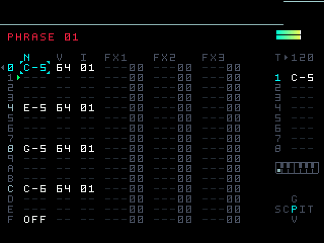
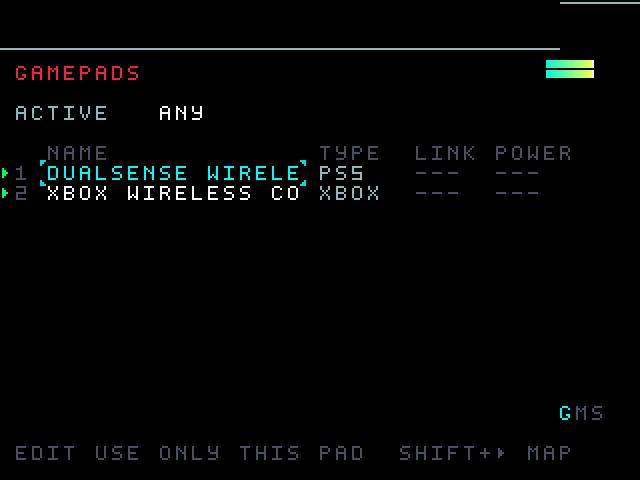
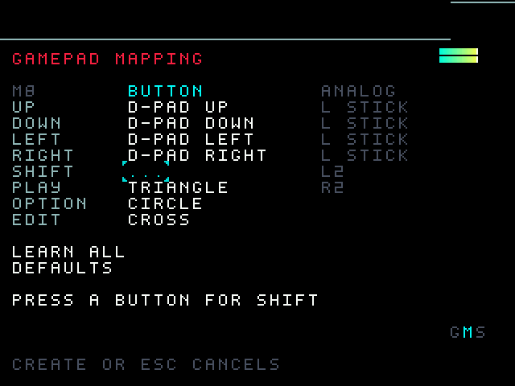
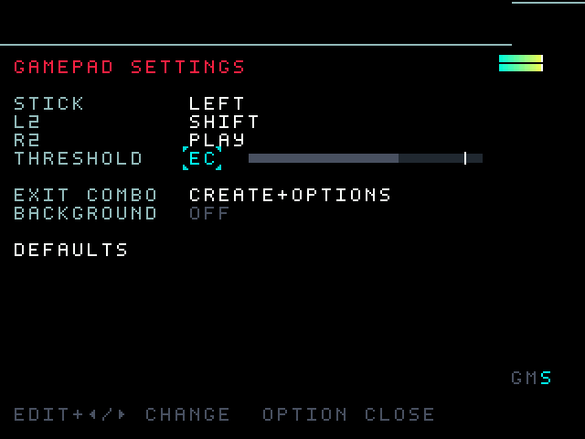

# m8emu-macos

This is m8emu reworked to run natively on macOS.



m8emu is an unofficial emulator of the Dirtywave M8 Headless. It runs the original 6.5.2C firmware without a Teensy. The firmware's Thumb-2 code is translated to C ahead of time and compiled into the emulator, with Unicorn kept as the reference and fallback engine. [Architecture](docs/architecture.md) explains how execution and timing work.

This fork of [karimkfoure/m8emu](https://github.com/karimkfoure/m8emu) adds a native Apple Silicon port on top of upstream v0.1.0. The port has been sent upstream as a pull request.

## Install

Download `m8emu-0.1.0-macos.1-arm64.zip` from the [Releases page](https://github.com/yukij3/m8emu-macos/releases) (tag `v0.1.0-macos.1`), unzip it and open `m8emu.app`. It needs an Apple Silicon Mac with macOS 13 or later. The app is self-signed and isn't notarized, so macOS blocks the first launch. Allow it in System Settings > Privacy & Security (Open Anyway), or run `xattr -dr com.apple.quarantine m8emu.app`.

## Build from source on macOS

You need the Xcode command line tools (Apple clang), CMake 3.21 or newer, Ninja and Python 3.9 or newer.

```sh
brew install cmake ninja python
git clone --recursive https://github.com/yukij3/m8emu-macos.git
cd m8emu-macos
cmake --preset macos && cmake --build --preset macos
```

The `macos` preset uses profile-guided optimization and takes about 10 minutes. For a faster build without it, use `cmake --preset macos-dev && cmake --build --preset macos-dev`. The build downloads and compiles a pinned SDL3 itself.

You get `build/macos/m8emu` with `lib/` and `firmware/` next to it, plus a self-contained `build/macos/m8emu.app` (arm64, macOS 13 or later). The app is signed ad hoc. To sign it with your own certificate, configure with `-DM8_CODESIGN_IDENTITY="<keychain identity>"`.

To check that it works without opening a window:

```sh
./build/macos/m8emu --headless --demo simple --seconds 6
```

Audio goes straight to Core Audio's HAL output unit with a 128-frame period and a 12 ms ring. SDL's AudioQueue path adds about 35 ms, so it is off by default. Set `SDL_AUDIO_DRIVER=coreaudio` to use SDL audio anyway. The stats line shows `device_latency_ms`, the output delay the device itself reports. MacBook Air speakers report about 17 ms.

On an Apple M5 the generated demo runs several times faster than real time, and PGO adds 8 to 12% over the dev build. PCM output is byte-identical to the Unicorn reference engine.

## Build on Linux

Linux works as upstream: `cmake --preset linux` (GCC, with PGO) or `cmake --preset linux-dev`. The `handheld-arm64` preset for ARM64 handhelds is experimental. See [building](docs/building.md).

## Controls

| Action | Key |
| --- | --- |
| Move | Arrow keys |
| SHIFT | Left Shift or Z |
| PLAY | Space or X |
| OPTION | Left Alt or A |
| EDIT | Left Ctrl or S |
| Note keyboard on/off | Esc |
| Settings | F1 |
| Mute host audio | F12 |
| Redraw display | R |
| Gamepad view | F3 or Cmd+G |

USB and Bluetooth gamepads work through SDL3 and GameController.framework: DualSense, DualShock 4, Xbox, Switch Pro, 8BitDo and others. You can connect a pad while the emulator runs, and if it disconnects, any buttons it was holding are released. By default the D-pad moves, the face buttons map by position (west SHIFT, north PLAY, east OPTION, south EDIT) and Back+Start exits.

The gamepad view is drawn like an M8 screen. Open it with F3, Cmd+G, or a tap on the pad's Back/Share/View button. SHIFT+LEFT/RIGHT switches between its three pages, and OPTION saves and closes it.

<p>
  
  
  
</p>

- GAMEPADS picks the active pad.
- GAMEPAD MAPPING: press EDIT on an action, then the button you want. LEARN ALL goes through every action and DEFAULTS resets them. A button that is already bound swaps places with the old one. OPTION+EDIT clears a binding.
- GAMEPAD SETTINGS has stick mode, trigger actions, threshold, the exit combo and background input.

Bindings are stored in the `[gamepad]` section of m8c's `config.ini`, in its SDL preference folder (`~/Library/Application Support/m8c/` on macOS). The view's own settings go to `m8emu_gamepad.ini` in the same folder.

## Card and projects

On macOS the default card is `~/Library/Application Support/m8-live/card.img`, unless `XDG_DATA_HOME` is set. On Linux it is `$XDG_DATA_HOME/m8-live/card.img` or `~/.local/share/m8-live/card.img`.

```sh
./build/macos/m8emu --card ./card.img                     # use another card image
./build/macos/m8emu --card ./card.img --import ./content  # add --overwrite to replace files
./build/macos/m8emu --card ./card.img export ./exported   # target must be new or empty
./build/macos/m8emu --card ./card.img --read-only
```

Save with SAVE or BUNDLE in the firmware before you quit. Closing the window does not save tracker edits. On a clean exit the emulator writes the card back and keeps the previous image as `.bak`.

## Limits

- Only firmware 6.5.2C runs, and the build checks its hash. Newer firmware such as 6.6.3E needs regenerated catalogs and doesn't boot.
- Host MIDI isn't wired up yet.
- Gamepads have only been tested with SDL virtual controllers so far. Physical Bluetooth pads are untested.
- Windows, Android and web aren't supported.

## Credits

[Dirtywave](https://dirtywave.com/) made the M8, and the build uses the pinned [M8 Headless Firmware](https://github.com/Dirtywave/M8HeadlessFirmware) submodule. The emulator itself is by [karimkfoure](https://github.com/karimkfoure/m8emu). The display renderer, input handling and configuration come from [laamaa/m8c](https://github.com/laamaa/m8c). [Unicorn](https://www.unicorn-engine.org/) is the reference CPU engine, through a [maintained fork](https://github.com/karimkfoure/unicorn/tree/m8/2.1.4). [SDL](https://libsdl.org/) handles windows, input and audio.

This project is unofficial and is not affiliated with Dirtywave. No project license has been selected. Third-party components retain their own terms.
